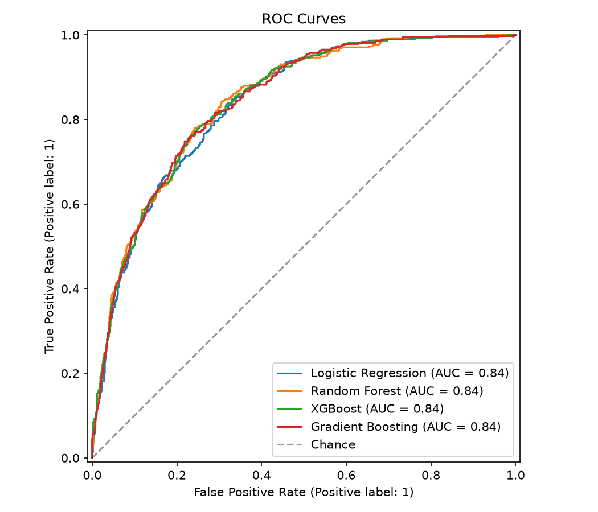
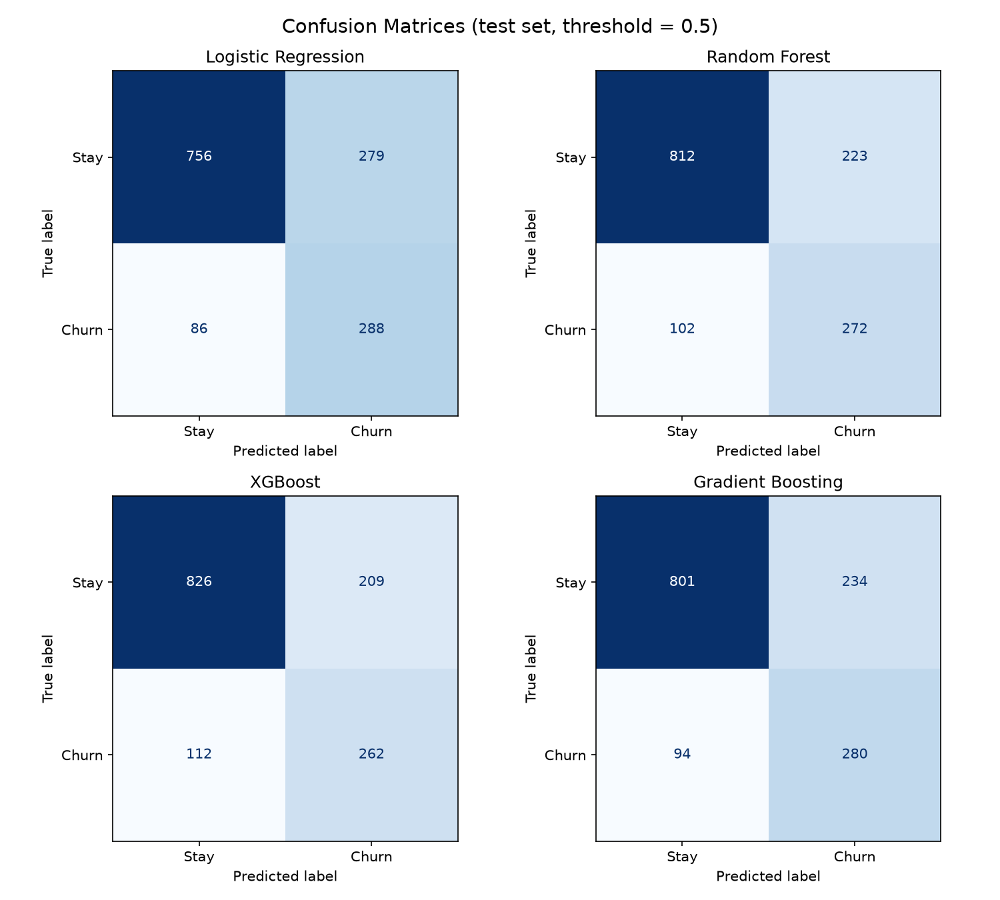

# 📉 Customer Churn Prediction System

An end-to-end machine learning project that predicts whether a telecom customer is likely to churn, explains **why**, and serves predictions through an interactive Streamlit web app.

**🔗 Live demo:** (https://leave-or-stay.streamlit.app/) 

 <!-- add a screenshot of your app -->

---

## 🎯 Problem

Acquiring a new customer costs far more than retaining an existing one. This project identifies customers at risk of leaving so a retention team can act early. A missed churner (false negative) is the most costly error, so the model is chosen with **recall** in mind, not accuracy alone.

## 📊 Dataset

[IBM Telco Customer Churn](https://www.kaggle.com/datasets/blastchar/telco-customer-churn): 7,043 customers, 20 features covering demographics, account details (tenure, contract, billing) and subscribed services. About 27% of customers churned, so the classes are imbalanced.

## 🔧 Methodology

1. **Cleaning:** converted `TotalCharges` to numeric (blank values for new customers filled with monthly charges), dropped `customerID`.
2. **Encoding & scaling:** one-hot encoding for categorical features; `StandardScaler` on tenure, monthly charges and total charges, **fitted on the training set only** to avoid data leakage.
3. **Split:** 80/20 stratified train/test split (`random_state=42`).
4. **Class imbalance:** SMOTE applied **inside each cross-validation fold** (via an `imblearn` pipeline), so synthetic samples never leak into validation data.
5. **Tuning:** `GridSearchCV` with stratified 5-fold CV, optimising F1-score.
6. **Evaluation:** all models scored on the same untouched test set.

## 🏆 Results

| Model                              | Accuracy | Precision | Recall    | F1    | ROC-AUC |
| ---------------------------------- | -------- | --------- | --------- | ----- | ------- |
| Gradient Boosting                  | 0.767    | 0.545     | 0.749     | 0.631 | 0.842   |
| Random Forest                      | 0.769    | 0.549     | 0.727     | 0.626 | 0.843   |
| XGBoost                            | 0.772    | 0.556     | 0.701     | 0.620 | 0.843   |
| **Logistic Regression (deployed)** | 0.741    | 0.508     | **0.770** | 0.612 | 0.838   |

<p float="left">
  
  
</p>

**Key findings**

- All four models perform **comparably** (F1 within ~2 points, ROC-AUC within 0.5 points). The differences are within the noise expected from a test set with only 374 churners.
- **Logistic Regression was deployed** because it has the highest churn recall (77%) and is directly interpretable, which makes per-customer explanations possible, at a cost of roughly 2 points of F1.

## 🖥️ The App

- Sidebar form for customer profile (tenure, contract, billing, services, demographics)
- Color-coded prediction: 🚨 **High Risk of Churn** / ✅ **Likely to Stay**
- Churn probability gauge and progress bar
- **Top 3 risk drivers** for each customer, computed from the model's coefficients (coefficient × scaled feature value)
- Suggested retention action based on the result

## 🚀 Run Locally

```bash
git clone https://github.com/<your-username>/<your-repo>.git
cd <your-repo>
pip install -r requirements.txt

# (Optional) retrain the model and regenerate model.pkl, scaler.pkl, columns.pkl
python src/train_model.py

# (Optional) reproduce the model comparison and charts
python src/compare_models.py

# Launch the app
streamlit run app.py
```

> The dataset CSV (`WA_Fn-UseC_-Telco-Customer-Churn.csv`) is only needed for retraining. Download it from Kaggle and place it in the `data/` folder.

## 📁 Project Structure

```
churn-prediction-app/
├── app.py                  # Streamlit application (entry point)
├── requirements.txt
├── README.md
├── .gitignore
├── src/
│   ├── train_model.py      # Trains Logistic Regression, exports artifacts
│   └── compare_models.py   # Compares 4 models, saves metrics and plots
├── models/
│   ├── model.pkl           # Trained Logistic Regression
│   ├── scaler.pkl          # Fitted StandardScaler
│   └── columns.pkl         # Training feature columns (exact order)
├── data/                   # Telco CSV goes here (see data/README.md)
├── results/                # Comparison table and evaluation charts
└── assets/                 # App screenshot
```

## ⚠️ Limitations

- The model captures **correlations** in one public dataset; it cannot show that a specific action (e.g. a discount) will prevent churn.
- SMOTE and class balancing shift predicted probabilities upward, so the scores are best used to **rank** customers by risk rather than as literal probabilities.
- The 0.5 decision threshold is a default. In practice it should be set from the relative cost of a missed churner versus an unnecessary retention offer.

## 🔮 Future Improvements

- Threshold optimisation based on business cost
- Batch scoring: upload a CSV and download a ranked list of at-risk customers
- SHAP-based explanations for the tree-based models
- Probability calibration

## 🛠️ Tech Stack

Python · pandas · scikit-learn · imbalanced-learn · XGBoost · Plotly · Streamlit

## 👤 Author

**Your Name** · [LinkedIn](https://linkedin.com/in/your-profile) · [GitHub](https://github.com/your-username)

_Built during an internship project and extended into a deployed application._
